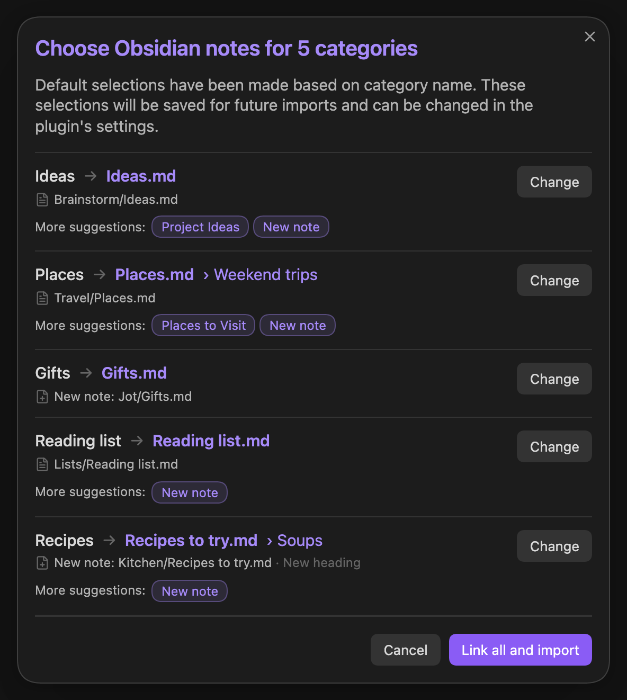

# Jot Import

[Jot](https://jotquick.app) is a private capture app for iPhone. Jot Import
brings Jot exports into your Obsidian vault. Each Jot category goes into the
Obsidian note you choose.

## How to use

1. In Jot, go to **Export ▸ Format** and turn on **Obsidian Format**. Then
   export your jots.
2. In Obsidian, run **Import a Jot export…** from the command palette and
   choose the file.
3. Choose an Obsidian note and heading for each category. Then import.

Jot Import remembers your choices for the next import. It always shows you
where the jots will go before it writes anything. Photos and files come
along when the export is a .zip.

On a phone it can be easier to save exports into your vault's **Jots**
folder. Turn on **Offer to import new Jot exports** in Jot Import's settings and
it offers to import each new one.

If you use Obsidian Sync, import on one device at a time. After you reinstall
Obsidian or a device has been offline, wait for Sync to finish before you
import. Otherwise Sync can merge two copies of an Obsidian note and repeat its
jots or properties.

## Install

Search for **Jot Import** in **Settings ▸ Community plugins ▸ Browse**.

Needs Obsidian 1.13 or later, on desktop or mobile.

## Privacy

Jot Import makes no network requests and collects no data. It reads only the
Jot export you pick with **Choose a file**, which can be outside your vault.
If you turn on **Offer to import new Jot exports**, it also checks new files in
your **Jots** folder to see if they're Jot exports. To find the notes linked to
Jot categories, it looks through your notes' properties. It writes only to the Obsidian notes you choose and saves the
export's photos and files. After an import it moves a Jot export in your vault
to the trash. You can turn that off in settings.

## License

MIT. Jot Import is not affiliated with Obsidian.
